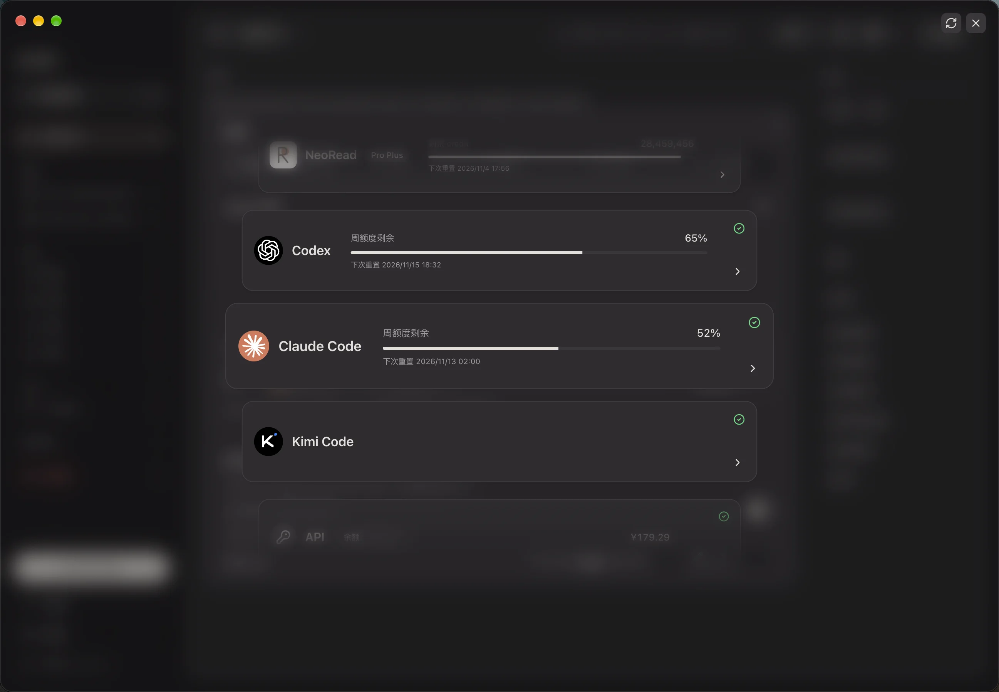

<p align="center">
  
</p>

<h1 align="center">NeoRead</h1>

<p align="center"><a href="README.md">简体中文</a> | <b>English</b> | <a href="https://neoread.app/">Website</a></p>

A local-first EPUB / PDF reader for books and papers, with side-by-side translations, annotations, and AI assistance grounded in the text you are reading.

<p align="center">
<picture>
  <source media="(prefers-color-scheme: dark)" srcset="website/assets/screenshots/pdf-dark.webp" />
  
</picture>
</p>

NeoRead treats EPUB and PDF as core document formats. It separates books and papers into two libraries and shares contents, search, bilingual reading, annotation, and chat tools across both. Documents, reading progress, and notes stay on your machine. The built-in Pi runtime supports ChatGPT, Claude, and Kimi Code account connections, provider API keys, and custom compatible endpoints.

Download installers from [GitHub Releases](https://github.com/cynicalight/NeoRead/releases): DMG for Apple Silicon Macs and EXE for Windows x64. Intel Mac builds are paused and Linux installers are not provided; you can also run from source. Installers have no trusted developer certificate and may require approval in your system security settings. See the [packaging and release guide (Chinese)](docs/releasing.md) for the workflow and validation scope.

## Features

**Libraries and paper management**

- **Book and paper libraries**: manage books and papers separately and move documents between them. The book library accepts EPUB / PDF; the paper library accepts PDFs up to 50 MB and 150 pages, asking first above 50 pages.
- **Paper metadata**: edit authors, year, venue, DOI, arXiv ID, abstract, and more. PDF and link imports queue the same pipeline used by manual metadata lookup; online completion never overwrites manual edits. A different AI-suggested title is also searched without directly replacing the current title. Common computing and engineering conferences use a built-in full-name/abbreviation catalog, with full names on hover or keyboard focus; abbreviation display does not replace stored venues or citation exports. Nested categories, tags with smart tag categories, list and sortable table views, reading status, batch actions, duplicate detection and merging, and two-way related papers.
- **Journal and conference ranks**: with an easyScholar key configured, show rank badges next to paper titles and choose which ranking systems to display. Venue or abbreviation changes automatically query the corresponding ranks, reusing local caches. Recognized conferences try the standard abbreviation first, then the full name if no result is found; aliases share a cache. Names are based on the [CCF seventh-edition catalog](https://www.ccf.org.cn/Academic_Evaluation/By_category/) and conference websites, not hard-coded ranks. Ambiguous abbreviations never merge distinct conferences; rankings come from easyScholar.
- **Several ways to add papers**: import by identifier, URL, or title; capture PDFs, metadata, and offline page snapshots from paper pages or search results with the [NeoRead Connector](docs/neoread-connector.md) Chrome extension (Chinese); or [migrate from a local Zotero library](docs/zotero-migration.md) (Chinese), including PDFs, metadata, collections, tags, notes, and convertible annotations.
- **Citations**: copy or batch-export GB/T 7714, APA, BibTeX, and RIS citations.
- **Trash**: deleted documents keep their files, annotations, and conversations until permanently deleted, and can be undone or restored.

**Reading and translation**

- **Shared reading interface**: contents and search on the left, the document in the center, and AI chat and notes on the right. Resize or hide the sidebars.
- **PDF analysis and translation**: page text and layout are analyzed locally; body text and captions are translated, and formula images are converted to LaTeX. Book PDFs are translated chapter by chapter. Progress appears as an overlay on the library cover, and you can read while processing continues. Hover a paragraph or figure to copy it, enlarge the original image, or ask AI about it.
- **Bilingual EPUB reading**: books render inside the app with continuous scrolling or page turns. “Translate chapter” translates the current chapter on demand; original and translation scroll together, sentences highlight across both, and annotations are shared between them. Translations have their own font, size, and weight settings.
- **Reading records**: bookmarks, highlights, underlines, question annotations, annotation tags, paper notes, and reading position restoration. Hover to preview notes; filter by color or tag, search notes, undo annotation changes, quote annotations, export Markdown, and open desktop `neoread://` links. PDF internal links support hover previews and returning to your reading position.
- **Reading preferences**: double-click to select a whole sentence, opt in to copying selections automatically, and customize highlight colors and translation fonts. Light, dark, paper, and system appearances also apply to the desktop window.

**AI assistance**

- **Questions and explanations**: translate or explain selections, quote multiple excerpts, summarize the current EPUB chapter or PDF page, revisit conversation history, and cancel generation. Questions include the paper title and abstract by default, with optional chapter text; questions about quoted excerpts include the surrounding chapter. Source references in answers jump back to the text and flash the source block.
- **Account and API connections**. Sign in to a provider account or configure an API key in Settings. Question answering and translation can use separate models and reasoning levels.

**Desktop app**

- **In-app updates**: check for and download new versions with visible progress. Fixed-certificate macOS builds update in place; Windows verifies and installs updates silently, then reopens NeoRead.
- **Proxy and diagnostics**: follow the system proxy, set a manual proxy, or connect directly, then test the connection. Export [diagnostic logs](docs/diagnostics.md) (Chinese) with sensitive fields filtered when something goes wrong.
- **Guide and release notes**: a first-run guide walks through Agent setup; each version ships offline release notes, and update prompts link to GitHub feedback.

See [paper-library behavior and manual checks (Chinese)](docs/paper-library.md) for import limits, online lookup, duplicate merging, and manual checks.

Each format retains reading controls suited to its layout:

| Capability                | EPUB                                                                        | PDF                                              |
| ------------------------- | --------------------------------------------------------------------------- | ------------------------------------------------ |
| Reading engine            | Sanitized chapters rendered in the app, parsed by Readium Go Toolkit        | PDF.js Viewer                                    |
| Navigation                | Nested table of contents, chapter, in-chapter and cross-chapter links       | Document outline, page navigation                |
| Layout                    | Continuous scrolling / page turns, font size, family, line spacing, margins | Continuous scrolling, zoom, fit to width         |
| Translation               | On-demand chapter translation, side by side with the original               | Analyzed and translated after import             |
| Search                    | SQLite FTS5 with literal substring matching                                 | Per-page text search                             |
| Positions and annotations | Chapter resources, block IDs, and character ranges                          | Page numbers and normalized selection rectangles |

In an empty library, click “先体验示例文档” (try sample documents) to load an original three-chapter EPUB and a two-page PDF included with the project.

## Screenshots

Captured from the app.

| Library                                                                                                                                                                                                                                        | Agent settings                                                                                                          |
| ---------------------------------------------------------------------------------------------------------------------------------------------------------------------------------------------------------------------------------------------- | ----------------------------------------------------------------------------------------------------------------------- |
|  |  |

## Quick start

Requires **Node.js 22+, pnpm 10.30.3, and Go 1.26.5+**.

```sh
git clone https://github.com/cynicalight/NeoRead.git
cd NeoRead
pnpm install
pnpm desktop
```

`pnpm desktop` builds the Go service, web interface, and Electron app, then opens the desktop window. The main API listens on a random loopback port and stops when the application closes.

If the Electron binary was not downloaded successfully during installation, run the following command and try again:

```sh
node apps/desktop/node_modules/electron/install.js
```

## Using AI

AI is optional. Local reading, search, and annotations do not require an AI account.

**Connect an account.** Open the ChatGPT, Claude, or Kimi Code card in Settings and follow the browser or device-code prompts. Available models depend on the connected account and its capability checks.

**Through an API**: choose API in Settings and enter the endpoint, key, and model. The request protocol is detected automatically for official endpoints, or you can choose OpenAI Chat Completions or Anthropic Messages manually; relay endpoints keep the root path you enter. The key is stored only by the local backend, and the interface only shows whether one is configured. See [API provider compatibility (Chinese)](docs/api-provider-compatibility.md) for per-provider reasoning effort rules.

Open NeoRead settings, choose a primary Agent, and check the text and image capability results. Successful real requests produce green capability badges and resume waiting PDF translations. Question answering and translation can use separate models and supported reasoning effort levels; unspecified models use the recommendations for each task.

The app bundles approximately 67 MB of layout-model weights, so the first PDF analysis can extract layout and locate image regions offline. Weights are fetched and verified during the build, not committed to Git. Python and PaddlePaddle do not need to be installed. Without a verified primary Agent, reading and region hover remain available while translation waits for configuration. Processing resumes after restart and reuses saved translations. Scanned pages are explicitly marked incomplete because OCR is not available.

**Using AI sends relevant content off your machine.** Capability tests use a synthetic image. With a verified primary Agent configured, imported PDF body text and captions are sent for translation and formula images for LaTeX conversion; figures and tables are not sent for interpretation. EPUB chapter text is sent only after you click “Translate chapter”. When you request a translation, explanation, summary, or send a question, NeoRead passes the selected excerpts, the paper title and abstract, any included chapter or current page context, and recent conversation history to the selected model service. Chapter and context lengths are limited; a summary of the current page is not a summary of the entire paper.

Pi workers run in private temporary directories and access documents through NeoRead tools. Text and image requests stream incrementally, and answers are saved after the model completes. See the [frontend integration contract (Chinese)](docs/agent-streaming-contract.md).

## Local data

Original files are stored on the filesystem. Document metadata, progress, annotations, conversations, and settings are stored in SQLite. NeoRead has no built-in cloud sync. Paper metadata lookup and online imports contact public paper services. Automatic completion first reads clues from the PDF's first two pages and searches using DOI/arXiv identifiers and available titles. If no reliable title is available, it can send up to 2,000 characters from the first page to the text model for a suggested title, then search a different suggested title as well. Only when metadata APIs still leave the venue empty, and a primary Agent and web search are configured and available, a final Agent lookup sends the title, authors, and existing identifiers to find the venue's full and short names; this venue lookup does not send document text or notes. An existing venue never triggers an Agent just to convert a name or recover missing ranks. Automatic completion can be turned off in Settings while manual lookup remains available. Journal and conference ranks are queried only after an easyScholar key is configured and are cached locally.

| Mode                                | Data directory                                                                                   |
| ----------------------------------- | ------------------------------------------------------------------------------------------------ |
| Installed desktop app               | Electron `userData/library/`; typically `~/Library/Application Support/NeoRead/library/` on macOS |
| Unpackaged desktop (`pnpm desktop`) | `~/Library/Application Support/NeoRead Dev/library/` on macOS                                     |
| Browser development (`pnpm dev`)    | `.neoread/` in the project root                                                                   |

Legacy Reader libraries usually live at `~/Library/Application Support/Reader/library/` on macOS. On its first launch, the installed NeoRead app copies and verifies the legacy library and related settings once, then offers an option to clean up the migrated legacy business data. Development runs do not read legacy Reader data. See the [migration guide](docs/neoread-migration.md) (Chinese) for scope, recovery, and cleanup rules.

```text
library/
├── neoread.sqlite       # Metadata, reading records, conversations, settings, and full-text index
├── books/              # Original EPUB files
├── papers/             # Original PDF files
├── cache/              # EPUB resources; Markdown, images, and drafts under PDF analysis
└── ai-work/            # Temporary Pi worker directories, removed after requests finish
```

Desktop runtime logs are kept in `userData/logs/` for up to 7 days and are never uploaded automatically. Close the application before backing up the entire data directory. The local API uses a randomly generated token for each launch and validates Host / Origin. EPUB imports check archive size and resource paths, and sanitize active content. Original files remain unchanged.

## Development

Start the Go service and the web interface with hot reload:

```sh
pnpm dev
```

The terminal prints a URL in the form `http://127.0.0.1:5173/#token=…`. Open the complete URL. Vite proxies requests to the Go service at `127.0.0.1:17840`. This token authenticates access to the local service; it is not an AI account credential. Do not share URLs containing the token.

Development runs leave the connector port disabled unless `NEOREAD_DEV_CONNECTOR=1` is set. Unpackaged desktop runs register `neoread://` only with `NEOREAD_DEV_PROTOCOL=1`.

`pnpm dev`, `pnpm desktop` and `pnpm build` prepare the pinned layout model before running. The first build downloads approximately 67 MB; later builds verify and reuse the ignored `apps/processor/models/` cache. For an offline build, set `NEOREAD_BUILD_LAYOUT_MODEL` to the absolute path of an existing copy of the pinned weights; size and SHA256 verification still apply. Installation, type checking and ordinary unit tests do not download the model.

```sh
pnpm typecheck     # TypeScript type checking
pnpm test          # Go integration tests and Vitest
pnpm build         # Build Go, web, and Electron
pnpm api:generate  # Regenerate client types from OpenAPI
```

The project website lives in `website/` as static HTML, CSS and JavaScript with no build step. Preview it locally with `python3 -m http.server 4321 -d website` and open `http://127.0.0.1:4321/`.

Tests cover document imports, persistence, resource access boundaries, Pi worker and model protocols, PDF parsing, and selected frontend regressions. Passing builds and tests does not replace manual checks with real documents and the application UI. See the [verification notes](docs/verification.md) (Chinese).

## Technology and structure

The frontend uses React, TypeScript, Vite, Tailwind CSS, shadcn/ui (Base UI), and Zustand. Electron manages windows, native file selection, app updates, and the Go service lifecycle. Go handles local documents, SQLite, search, and AI calls. PDF layout analysis runs locally in a Node processor with ONNX Runtime.

```text
apps/
├── desktop/       # Electron main / preload
├── web/           # React UI, PDF.js and EPUB reader adapters
├── server/        # Go local service
├── processor/     # PDF layout analysis and the local layout model
└── connector/     # NeoRead Connector Chrome extension
packages/
├── ui/            # shadcn/ui + Base UI components
├── neoread-core/   # Document, Location, TOC, Annotation, ReaderAdapter
└── api-client/    # OpenAPI types and API client
docs/              # Scope, roadmap, API contract, and verification notes
website/           # Static project website and README screenshots
assets/            # Logo sources and app icons
```

The domain model centers on `Document`. PDF positions use page numbers and coordinates; EPUB positions use chapter resources, block IDs, and character ranges. The reading interface accesses each engine through `ReaderAdapter`. The project uses pnpm workspaces without Nx or Turborepo.

## Current limitations and next steps

The current version primarily targets DRM-free, horizontal left-to-right reflowable EPUBs and PDFs with text. OCR, password entry for protected PDFs, PDF thumbnails, background PDF full-text indexing, cross-document AI retrieval, independent conversation management, Ollama, and reading statistics are not yet supported. Highlights are not created for complex PDF selections spanning multiple pages.

Fixed-layout EPUBs, vertical text, RTL, complex footnotes, and large files need more testing with real documents. The desktop app handles macOS file-open events, but system file associations are not registered. Installers are built by CI without trusted developer signing or macOS notarization. See the [release and update guide (Chinese)](docs/releasing.md) for in-app update requirements.

Planned for October 2026:

- **NeoRead command line**: search, read, and import library documents from the terminal, for agents such as Claude Code and Codex as well as scripts.
- **RAG support**: a broad upgrade to AI question answering, grounding answers in passages retrieved across chapters and documents.
- **Large EPUB translation**: faster chapter translation, better job scheduling, and smoother resumption for long books.

See the [roadmap](docs/roadmap.md) (Chinese) for longer-term plans.

## Star History

<a href="https://www.star-history.com/?repos=cynicalight%2FNeoRead&amp;type=date&amp;legend=top-left">
  <picture>
    <source media="(prefers-color-scheme: dark)" srcset="https://api.star-history.com/svg?repos=cynicalight/NeoRead&amp;type=date&amp;legend=top-left&amp;theme=dark" />
    
  </picture>
</a>

## Acknowledgments

Thanks to [Readium](https://github.com/readium), [PDF.js](https://github.com/mozilla/pdf.js), [shadcn/ui](https://github.com/shadcn-ui/ui), and [Base UI](https://github.com/mui/base-ui). The shadcn components are included in `packages/ui`; their license is available in [packages/ui/LICENSE.md](packages/ui/LICENSE.md). See [third-party sources](docs/sources.md) (Chinese) for further attribution.

[Project scope](docs/spec.md) · [Roadmap](docs/roadmap.md) · [OpenAPI](docs/openapi.yaml) · [Verification notes](docs/verification.md)
